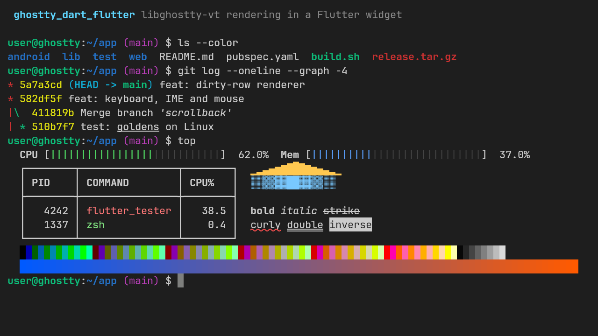

<!-- source: README.md@7dcd0e72f4269f7424a0113d7862ed44ba11a533 -->
[English](https://github.com/AlonsoMCarlos/ghostty_dart/blob/main/packages/ghostty_dart_flutter/README.md) | **Español**

# ghostty_dart_flutter

[](https://pub.dev/packages/ghostty_dart_flutter)
[](https://pub.dev/packages/ghostty_dart_flutter/score)
[](https://github.com/AlonsoMCarlos/ghostty_dart/actions/workflows/ci.yml)
[](https://github.com/AlonsoMCarlos/ghostty_dart/blob/main/packages/ghostty_dart_flutter/LICENSE)

Un *widget* de terminal para Flutter sobre
[`ghostty_dart`](https://pub.dev/packages/ghostty_dart), los *bindings* de
Dart para [libghostty-vt](https://lib.ghostty.org/vt/) 1.x, el motor de
emulación de terminal de [Ghostty](https://ghostty.org). Conéctalo a una
pty, un *socket* o un canal SSH: dibuja la pantalla y envía al programa las
teclas, el texto, el ratón y los toques del usuario.

> [!NOTE]
> **No oficial.** Es un proyecto independiente, sin afiliación, respaldo
> ni patrocinio del proyecto Ghostty ni de Hack Club. «Ghostty» es una
> marca de sus respectivos titulares y aquí solo se usa para describir la
> base sobre la que se construye este paquete.



Todavía no hay demo web en vivo: espera al *backend* web (wasm) de
`ghostty_dart`. La [aplicación de demostración](https://github.com/AlonsoMCarlos/ghostty_dart/tree/main/apps/demo)
ejecuta tu shell en Linux, macOS y Windows.

- **El motor de terminal de Ghostty.** El análisis de la salida, la
  pantalla, el historial (*scrollback*), la codificación de teclas (la
  heredada y el protocolo de teclado de Kitty), los informes de ratón, la
  selección y la protección al pegar vienen de libghostty-vt 1.0, el mismo
  código que ejecuta la aplicación Ghostty.
- **Solo dibuja lo que cambia.** La vista vuelve a grabar únicamente las
  filas que el terminal marca como modificadas, con un párrafo por fila, y
  conserva el resto (y el contenido de fila mostrado hace poco) como
  imágenes en caché. Un terminal inactivo
  no vuelve a grabar nada.
- **No le roba las teclas a la shell.** Ctrl+V y Ctrl+A llegan al programa;
  copiar y pegar siguen la convención de los terminales de tu plataforma.
  Incluye composición con IME, teclados en pantalla (con una barra de
  teclas para Esc, Ctrl, Alt, Tab y flechas), seguimiento del ratón que se
  puede saltar con Mayús y texto para lectores de pantalla.

## Plataformas

| Plataforma | Estado | Pruebas |
|---|---|---|
| Linux | ✅ | Pruebas de *widgets* y *goldens* en CI; compilación de la demo en CI |
| macOS | ✅ | Pruebas de *widgets* en CI (los *goldens* son solo de Linux) |
| Windows | ✅ | Pruebas de *widgets* en CI (los *goldens* son solo de Linux) |
| Android, iOS | ⚠️ | Aún no se ha probado en un dispositivo (se comprueba el formato de la biblioteca nativa) |
| Web | — | Previsto: necesita un *backend* wasm en `ghostty_dart` |

La biblioteca nativa la proporciona el *build hook* de `ghostty_dart` (por
defecto, un binario precompilado y fijado por sha256); consulta su
[tabla de plataformas](https://github.com/AlonsoMCarlos/ghostty_dart/blob/main/packages/ghostty_dart/README.es.md#plataformas).

## Inicio rápido

```sh
flutter pub add ghostty_dart_flutter
```

El controlador no depende de ninguna pty: escribe en él la salida del
programa y envía lo que emite (`onOutput`) a la entrada del programa.

```dart
import 'package:flutter/material.dart';
import 'package:ghostty_dart_flutter/ghostty_dart_flutter.dart';

final controller = VtTerminalController(
  onOutput: (bytes) => connection.add(bytes), // keys, pastes, replies
  onResize: (cols, rows, pixelWidth, pixelHeight) =>
      connection.resize(rows: rows, cols: cols), // tell the pty the new size
);
connection.listen(controller.writeBytes); // the program's output (Uint8List)

Widget build(BuildContext context) => VtTerminalView(
  controller: controller,
  autofocus: true,
  textStyle: const TextStyle(fontFamily: 'JetBrains Mono', fontSize: 14),
);
// When done: controller.dispose(). The view never disposes it.
```

- [`example/lib/main.dart`](https://github.com/AlonsoMCarlos/ghostty_dart/blob/main/packages/ghostty_dart_flutter/example/lib/main.dart)
  es una aplicación completa con un eco local en lugar de una shell, así
  que funciona sin pty.
- [`apps/demo`](https://github.com/AlonsoMCarlos/ghostty_dart/tree/main/apps/demo)
  conecta tu shell real mediante
  [`flutter_pty2`](https://pub.dev/packages/flutter_pty2) (bytes de
  entrada y salida, escrituras que no bloquean, un `close()` real), con
  cambio de tamaño, título y reinicio al salir. `ghostty_dart_flutter` no
  depende de ningún paquete de pty. flutter_pty2 es joven (tres versiones
  mayores en 2026, pocos usuarios) y compila su propio código C en tu
  máquina mediante un build hook, así que necesita clang (Linux), Xcode
  (macOS) o Visual Studio (Windows); fija su versión y revísalo como
  cualquier otra dependencia nativa. El README de la demo enumera lo que
  comprobamos y lo que queda pendiente.

Incluye una fuente monoespaciada en tu aplicación: Flutter no tiene una
familia monoespaciada portable, y las celdas se miden con la fuente que
indiques.

## Migrar desde xterm

Está previsto un adaptador con exactamente la API pública de
[`xterm`](https://pub.dev/packages/xterm) 4.0.0 (`ghostty_dart_xterm`), pero
todavía no existe. Migrar a mano es breve, porque las formas se parecen:

| `xterm` 4.0.0 | `ghostty_dart_flutter` |
|---|---|
| `Terminal` + `TerminalView(terminal)` | `VtTerminalController` + `VtTerminalView(controller: ...)` |
| `terminal.write(String)` | `controller.write(String)` o `controller.writeBytes(Uint8List)` |
| `terminal.onOutput` (`String`) | `onOutput` (`Uint8List`, ya en UTF-8) |
| `terminal.onResize(w, h, pw, ph)` | `onResize(cols, rows, pixelWidth, pixelHeight)` |
| `TerminalView(theme: ...)` | `controller.theme = VtTerminalTheme(...)` |

Comportamiento que difiere a propósito:

- **Ctrl+V y Ctrl+A van a la shell.** xterm 4.0.0 los asocia a pegar y a
  seleccionar todo. Aquí se copia con Ctrl+Mayús+C o Ctrl+Insert, se pega
  con Ctrl+Mayús+V o Mayús+Insert, y con Cmd+C y Cmd+V en las plataformas
  de Apple, como en la mayoría de los terminales de escritorio. Pasa
  `shortcuts:` para cambiarlos.
- **Los pegados inseguros se retienen.** El texto con un salto de línea
  pegado en un programa sin *bracketed paste* solo se pega si
  `onUnsafePaste` devuelve `true`.
- **El historial se limita en bytes** (10 MiB por defecto), no en líneas;
  también está disponible `scrollbackMaxLines`.

## Benchmarks

Tiempos de fotograma frente a `xterm` 4.0.0 y `xterm2` 5.4.0, con los
mismos flujos de bytes en una rejilla de 200 × 60, medidos el 10 de
noviembre de 2026 en una sola máquina virtual en la nube (AMD Ryzen 5 3600,
6 vCPU, **sin GPU**: Xvfb con el rasterizador por software de Mesa),
Flutter 3.47.9, Impeller (OpenGL ES), relación de píxeles 2, modo
*profile*, 3 pasadas de 300 fotogramas. Tiempo medio de UI (construcción,
*layout* y pintado) por fotograma, más la escritura previa, en ms:

| Escenario | ghostty_dart_flutter | xterm 4.0.0 | xterm2 5.4.0 |
|---|---:|---:|---:|
| inactivo (fotograma forzado, sin cambios) | 0,14 | 0,15 | 0,15 |
| 3 filas reescritas con texto nuevo por fotograma | **2,49** | 19,11 | 25,49 |
| salida que se desplaza (`cat`, 6 líneas por fotograma) | **1,76** | 5,87 | 6,43 |
| pantalla completa de texto nuevo por fotograma | 32,30 | **21,58** | 25,51 |
| tipo htop: cambia el 20 % de las celdas, en todas las filas, por fotograma | 33,32 | **19,63** | 24,02 |
| pantalla completa, 8 pantallas repetidas (reproducción de caché) | 3,05 | 20,42 | 25,83 |

- **Más rápido** cuando cambian pocas filas (una shell, escribir en un
  editor: unas 7,7 veces menos que `xterm`) y con salida que se desplaza
  (unas 3,3 veces): solo se maquetan las filas que cambian, y las filas
  desplazadas conservan sus imágenes.
- **Más lento** cuando la mayoría de las filas recibe texto nuevo en cada
  fotograma: una pantalla completa de texto nuevo es unas 1,5 veces más
  lenta que con `xterm`, y una pantalla tipo htop, unas 1,7 veces (y
  `xterm2` también es más rápido). Este *widget* maqueta un párrafo por
  fila modificada; los de xterm reutilizan un párrafo en caché por
  carácter y estilo. Está previsto un atlas de glifos para cerrar esta
  diferencia.
- La fila de reproducción de caché solo muestra lo barata que es una fila
  en caché: el *widget* guarda como imágenes las filas mostradas hace
  poco, con un presupuesto de unos 16 MiB por vista (que se libera cuando
  la vista se oculta, se desvincula o hay presión de memoria).
- El tiempo de rasterizado fue de unos 100 ms por fotograma para este
  *widget* y de 90 a 160 ms para los otros, pero es rasterizado por
  software de una ventana de 3600 × 2200 px, así que no dice nada sobre una
  GPU. Repite el *benchmark* en tu hardware antes de citar una cifra.

La tabla completa (p90, p99, peor caso, rasterizado, escritura), la
metodología y el comando están en
[`benchmarks/README.md`](https://github.com/AlonsoMCarlos/ghostty_dart/blob/main/benchmarks/README.md#frame-time-benchmark-widgets) (en inglés).

## Comparación

Datos a 10 de noviembre de 2026. Cada proyecto eligió un equilibrio
distinto y, en particular, `xterm` es hoy la opción madura y más usada.

| Paquete | Motor | Web | Estrategia de repintado | API de `xterm` 4.0.0 |
|---|---|---|---|---|
| `ghostty_dart_flutter` (sin publicar) | libghostty-vt 1.0.0 (ABI en C estable), FFI | No (previsto) | Solo filas modificadas, un párrafo por fila, imágenes de fila en caché por contenido | No (adaptador previsto) |
| [`xterm`](https://pub.dev/packages/xterm) 4.0.0 | Dart puro | Sí | Toda la pantalla en cada cambio, un párrafo por celda | Es la API |
| [`xterm2`](https://pub.dev/packages/xterm2) 5.4.0 | Dart puro (`xterm2_core`) | Sí | Pinta celda a celda | La misma API (es un *fork*) |
| [`flterm`](https://pub.dev/packages/flterm) 0.0.6 (+ [`libghostty`](https://pub.dev/packages/libghostty) 0.0.13) | Un *commit* de libghostty-vt anterior a 1.0, FFI y wasm | Sí | Atlas de glifos con `drawRawAtlas` | No |

Lo que `ghostty_dart_flutter` **todavía no** hace: no funciona en la web,
no se ha probado en dispositivos Android e iOS, y no puede sustituir a
`package:xterm` en una aplicación existente sin cambiar código. Si hoy
necesitas algo de eso, los paquetes anteriores ya lo ofrecen. `flterm` no
está en nuestro *benchmark* de fotogramas porque se basa en otra
libghostty-vt.

## Cadena de suministro

- **Una sola dependencia además de Flutter:** `ghostty_dart`, del mismo
  repositorio. Su *build hook* descarga una libghostty-vt precompilada
  para tu plataforma, la comprueba contra un sha256 fijado en su código
  fuente, hace fallar la compilación si no coincide y nunca ejecuta código
  descargado. Los binarios se compilan en la CI de este repositorio a
  partir del código fuente firmado de upstream, con atestaciones de
  procedencia; todos salvo los de Apple son reproducibles bit a bit.
- **Sin código propio en tiempo de compilación.** Este paquete no tiene
  *build hook* ni código nativo.
- El repositorio versiona sus *lockfiles*, fija sus GitHub Actions por
  *commit* y no adopta ninguna versión de una dependencia con menos de 3
  días. Los detalles están en la
  [política de seguridad](https://github.com/AlonsoMCarlos/ghostty_dart/blob/main/SECURITY.es.md).

## Documentación

- [Referencia de la API](https://pub.dev/documentation/ghostty_dart_flutter/latest/) (en inglés)
- [`ghostty_dart`](https://pub.dev/packages/ghostty_dart), para la API del
  terminal que hay detrás de `controller.terminal` y las opciones del
  *build hook*
- [Registro de cambios](https://github.com/AlonsoMCarlos/ghostty_dart/blob/main/packages/ghostty_dart_flutter/CHANGELOG.md) (en inglés)
- [Cómo contribuir](https://github.com/AlonsoMCarlos/ghostty_dart/blob/main/CONTRIBUTING.es.md)
  y [política de seguridad](https://github.com/AlonsoMCarlos/ghostty_dart/blob/main/SECURITY.es.md)
- [*Issues*](https://github.com/AlonsoMCarlos/ghostty_dart/issues)

## Licencia

Este paquete tiene licencia MIT (consulta
[LICENSE](https://github.com/AlonsoMCarlos/ghostty_dart/blob/main/packages/ghostty_dart_flutter/LICENSE)).
libghostty-vt, que `ghostty_dart` proporciona como biblioteca nativa,
también tiene licencia MIT (Copyright (c) 2024 Mitchell Hashimoto, Ghostty
contributors); las aplicaciones que la distribuyan deben incluir su aviso.
