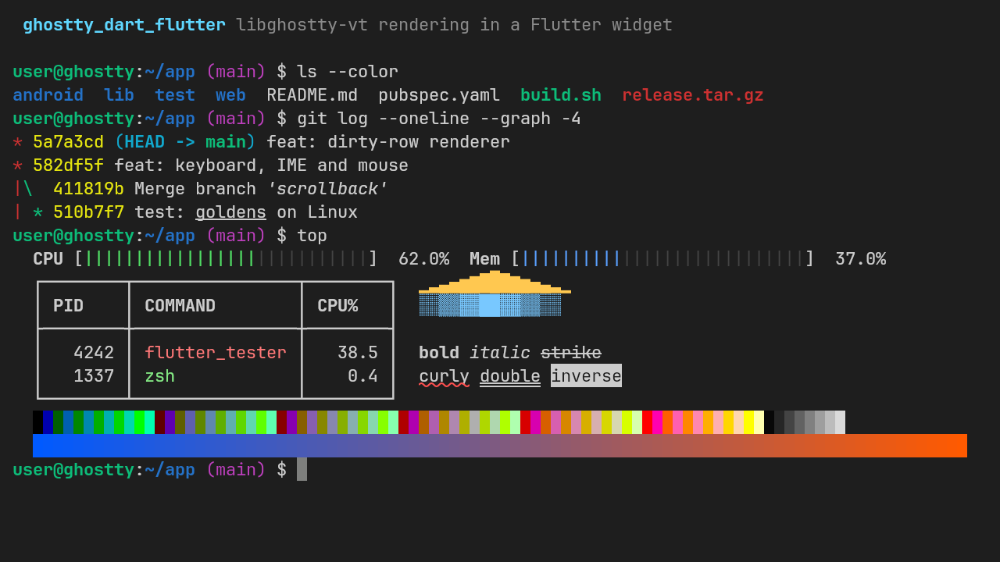

# ghostty_dart_flutter

[](https://pub.dev/packages/ghostty_dart_flutter)
[](https://pub.dev/packages/ghostty_dart_flutter/score)
[](https://github.com/AlonsoMCarlos/ghostty_dart/actions/workflows/ci.yml)
[](https://github.com/AlonsoMCarlos/ghostty_dart/blob/main/packages/ghostty_dart_flutter/LICENSE)

**English** | [Español](https://github.com/AlonsoMCarlos/ghostty_dart/blob/main/packages/ghostty_dart_flutter/README.es.md)

A Flutter terminal widget on top of
[`ghostty_dart`](https://pub.dev/packages/ghostty_dart), the Dart bindings
for [libghostty-vt](https://lib.ghostty.org/vt/) 1.x, the terminal
emulation engine of [Ghostty](https://ghostty.org). Connect it to a pty, a
socket or an SSH channel and it draws the screen and sends the user's
keys, text, mouse and touch input back.

> [!NOTE]
> **Unofficial.** This is an independent project. It is not affiliated
> with, endorsed by or sponsored by the Ghostty project or Hack Club.
> "Ghostty" is a trademark of its respective owners and is used here only
> to describe what this package builds on.



There is no live web demo yet: it waits for the web (wasm) backend of
`ghostty_dart`. The [demo app](https://github.com/AlonsoMCarlos/ghostty_dart/tree/main/apps/demo)
runs your shell on Linux, macOS and Windows.

- **Ghostty's terminal engine.** Parsing, the screen, scrollback, key
  encoding (legacy and the Kitty keyboard protocol), mouse reports,
  selection and paste protection all come from libghostty-vt 1.0, the
  same code the Ghostty app runs.
- **Draws only what changed, without laying out text.** The view
  re-records only the rows the terminal marks dirty, drawing their glyphs
  from a glyph atlas with one `drawRawAtlas` call per row, and keeps every
  other row (and recently shown row content) as a cached picture. An idle
  terminal re-records nothing.
- **Does not steal the shell's keys.** Ctrl+V and Ctrl+A reach the program;
  copy and paste use your platform's terminal convention. IME composition,
  soft keyboards (with a key toolbar for Esc, Ctrl, Alt, Tab and arrows),
  mouse tracking with a Shift bypass, and screen-reader text are built in.

## Platforms

| Platform | Status | Tested |
|---|---|---|
| Linux | ✅ | Widget tests and goldens in CI; demo build in CI |
| macOS | ✅ | Widget tests in CI (goldens are Linux only) |
| Windows | ✅ | Widget tests in CI (goldens are Linux only) |
| Android, iOS | ⚠️ | Not yet tried on a device (the native library is format-checked) |
| Web | — | Planned: needs a wasm backend in `ghostty_dart` |

The native library comes from `ghostty_dart`'s build hook (a prebuilt,
sha256-pinned binary by default); see its
[platform table](https://github.com/AlonsoMCarlos/ghostty_dart/blob/main/packages/ghostty_dart/README.md#platforms).

## Quick start

```sh
flutter pub add ghostty_dart_flutter
```

The controller is pty-agnostic: write the program's output into it, and
send what it emits (`onOutput`) to the program's input.

```dart
import 'package:flutter/material.dart';
import 'package:ghostty_dart_flutter/ghostty_dart_flutter.dart';

final controller = VtTerminalController(
  onOutput: (bytes) => connection.add(bytes), // keys, pastes, replies
  onResize: (cols, rows, pixelWidth, pixelHeight) =>
      connection.resize(rows: rows, cols: cols), // tell the pty the new size
);
connection.listen(controller.writeBytes); // the program's output (Uint8List)

Widget build(BuildContext context) => VtTerminalView(
  controller: controller,
  autofocus: true,
  textStyle: const TextStyle(fontFamily: 'JetBrains Mono', fontSize: 14),
);
// When done: controller.dispose(). The view never disposes it.
```

- [`example/lib/main.dart`](https://github.com/AlonsoMCarlos/ghostty_dart/blob/main/packages/ghostty_dart_flutter/example/lib/main.dart)
  is a complete app with a local echo instead of a shell, so it runs
  without a pty.
- [`apps/demo`](https://github.com/AlonsoMCarlos/ghostty_dart/tree/main/apps/demo)
  connects your real shell through
  [`flutter_pty2`](https://pub.dev/packages/flutter_pty2) (bytes in and
  out, non-blocking writes, a real `close()`), with resize, title and
  restart on exit. `ghostty_dart_flutter` does not depend on any pty
  package. flutter_pty2 is young (three major versions in 2026, few users)
  and compiles its own C code on your machine through a build hook, so it
  needs clang (Linux), Xcode (macOS) or Visual Studio (Windows); pin it and
  review it as you would any native dependency. The demo's README lists
  what we checked and what is left.

Bundle a monospace font with your app: Flutter has no portable monospace
family, and the cells are measured from the font you pass.

## Migrating from xterm

[`ghostty_dart_xterm`](https://github.com/AlonsoMCarlos/ghostty_dart/blob/main/packages/ghostty_dart_xterm) (not on pub.dev yet) mirrors the public API
of [`xterm`](https://pub.dev/packages/xterm) 4.0.0 on top of this widget, so
most apps move by changing the import; its
[`COMPATIBILITY.md`](https://github.com/AlonsoMCarlos/ghostty_dart/blob/main/packages/ghostty_dart_xterm/COMPATIBILITY.md) lists every member that differs and its
[migration guide](https://github.com/AlonsoMCarlos/ghostty_dart/blob/main/packages/ghostty_dart_xterm/MIGRATING_FROM_XTERM.md) explains each difference. To use
this widget directly instead, the shapes are close:

| `xterm` 4.0.0 | `ghostty_dart_flutter` |
|---|---|
| `Terminal` + `TerminalView(terminal)` | `VtTerminalController` + `VtTerminalView(controller: ...)` |
| `terminal.write(String)` | `controller.write(String)` or `controller.writeBytes(Uint8List)` |
| `terminal.onOutput` (`String`) | `onOutput` (`Uint8List`, already UTF-8) |
| `terminal.onResize(w, h, pw, ph)` | `onResize(cols, rows, pixelWidth, pixelHeight)` |
| `TerminalView(theme: ...)` | `controller.theme = VtTerminalTheme(...)` |

Behaviour that differs on purpose:

- **Ctrl+V and Ctrl+A go to the shell.** xterm 4.0.0 binds them to paste
  and select all. Here copy is Ctrl+Shift+C or Ctrl+Insert, paste is
  Ctrl+Shift+V or Shift+Insert, and Cmd+C and Cmd+V on Apple platforms, as
  in most desktop terminals. Pass `shortcuts:` to change them.
- **Unsafe pastes are held back.** Text with a newline, pasted into a
  program without bracketed paste, is pasted only if `onUnsafePaste`
  returns `true`.
- **Scrollback is limited in bytes** (10 MiB by default), not lines;
  `scrollbackMaxLines` is available too.

## Benchmarks

Frame times against `xterm` 4.0.0 and `xterm2` 5.4.0, with the same byte
streams on a 200 × 60 grid, measured on 2026-11-11 on one cloud VM (AMD
Ryzen 5 3600, 6 vCPUs, **no GPU**: Xvfb with Mesa's software rasteriser),
Flutter 3.47.9, Impeller (OpenGL ES), device pixel ratio 2, profile mode,
3 passes of 300 frames. Average UI time (build, layout and paint) per
frame, plus the write before it, in ms. "paragraphs" is this view with
`textRendering: VtTextRendering.paragraphs`:

| Scenario | ghostty_dart_flutter | (paragraphs) | xterm 4.0.0 | xterm2 5.4.0 |
|---|---:|---:|---:|---:|
| idle (forced frame, nothing changed) | 0.14 | 0.14 | 0.15 | 0.15 |
| 3 rows rewritten with new text per frame | **0.88** | 2.48 | 19.94 | 26.40 |
| scrolling output (`cat`, 6 lines per frame) | **1.24** | 1.84 | 6.42 | 7.07 |
| full screen of new text per frame | **6.39** | 33.13 | 22.52 | 27.55 |
| htop-like: 20 % of cells, every row, change per frame | **6.15** | 35.13 | 21.15 | 25.48 |
| full screen, 8 screens repeated (cache replay) | **3.14** | 3.16 | 21.84 | 27.95 |

- **Faster in every scenario that changes the screen:** about 23× less UI time than `xterm`
  4.0.0 when a few rows change (a shell, typing in an editor), 5.2× on
  scrolling output, 3.5× on a full screen of new text or an htop-like
  screen, and 7× when a program switches between screens it drew before.
  Only changed rows are recorded, their glyphs come from an atlas instead
  of a text layout, and rows are cached by content.
- **Memory is bounded per view:** cached row pictures, atlas images and
  laid-out text share `cacheBudget` (16 MiB by default; released when the
  view is hidden, detached or under memory pressure). That holds the
  replay's eight heavily coloured 200 × 60 screens with room to spare.
- **Raster time is higher than with paragraphs** on this software
  rasteriser: about 122–126 ms per frame with the atlas, 98–102 ms with
  paragraphs, 134–155 ms for the xterm widgets (79–82 ms while
  scrolling). It is software rendering of a 3600 × 2200 px window, where
  each glyph is a textured quad. On a GPU the ratio reverses: on a
  GitHub-hosted macOS runner (Apple M1, virtual; Impeller on Metal; DPR 1,
  7 px font, so indicative only) a fresh full screen rasterised in 1.9 ms
  with the atlas, 5.6 ms with paragraphs and 24–26 ms for the xterm
  widgets. If raster time matters on your device, measure both paths.

The full table (p90, p99, worst, raster, write), the methodology and the
command are in
[`benchmarks/README.md`](https://github.com/AlonsoMCarlos/ghostty_dart/blob/main/benchmarks/README.md#frame-time-benchmark-widgets).

## How it compares

Facts as of 2026-11-10. Each project made a different trade-off, and
`xterm` in particular is the mature, widely used choice today.

| Package | Engine | Web | Repaint strategy | `xterm` 4.0.0 API |
|---|---|---|---|---|
| `ghostty_dart_flutter` 0.1.0 | libghostty-vt 1.0.0 (stable C ABI), FFI | No (planned) | Dirty rows only, `drawRawAtlas` glyph atlas (row paragraphs as an option), row pictures cached by content | Through [`ghostty_dart_xterm`](https://github.com/AlonsoMCarlos/ghostty_dart/blob/main/packages/ghostty_dart_xterm) (unreleased) |
| [`xterm`](https://pub.dev/packages/xterm) 4.0.0 | Pure Dart | Yes | Whole screen on every change, paragraph per cell | It is the API |
| [`xterm2`](https://pub.dev/packages/xterm2) 5.4.0 | Pure Dart (`xterm2_core`) | Yes | Paints per cell | Same API (a fork) |
| [`flterm`](https://pub.dev/packages/flterm) 0.0.6 (+ [`libghostty`](https://pub.dev/packages/libghostty) 0.0.13) | A pre-1.0 libghostty-vt commit, FFI and wasm | Yes | `drawRawAtlas` glyph atlas | No |

What `ghostty_dart_flutter` does **not** do yet: it does not run on the
web, it has not been tested on Android and iOS devices, and its own API is
not xterm's (the `ghostty_dart_xterm` adapter, not published yet, covers
that). If you
need any of those today, the packages above already offer them. `flterm`
is not in our frame benchmark because it builds on a different
libghostty-vt.

## Supply chain

- **One dependency besides Flutter:** `ghostty_dart`, from the same
  repository. Its build hook downloads a prebuilt libghostty-vt for your
  target, checks it against a sha256 pinned in its source, fails the build
  on a mismatch, and never runs downloaded code. The binaries are built in
  this repository's CI from the signed upstream source, with provenance
  attestations; all but the Apple ones are bit-reproducible.
- **No build-time code of its own.** This package has no build hook and no
  native code.
- The repository commits its lockfiles, pins its GitHub Actions by commit,
  and does not adopt any dependency version younger than 3 days. Details
  are in the
  [security policy](https://github.com/AlonsoMCarlos/ghostty_dart/blob/main/SECURITY.md).

## Documentation

- [API reference](https://pub.dev/documentation/ghostty_dart_flutter/latest/)
- [`ghostty_dart`](https://pub.dev/packages/ghostty_dart), for the
  terminal API behind `controller.terminal` and the build hook options
- [Changelog](https://github.com/AlonsoMCarlos/ghostty_dart/blob/main/packages/ghostty_dart_flutter/CHANGELOG.md)
- [Contributing](https://github.com/AlonsoMCarlos/ghostty_dart/blob/main/CONTRIBUTING.md)
  and [security policy](https://github.com/AlonsoMCarlos/ghostty_dart/blob/main/SECURITY.md)
- [Issues](https://github.com/AlonsoMCarlos/ghostty_dart/issues)

## License

This package is MIT licensed (see
[LICENSE](https://github.com/AlonsoMCarlos/ghostty_dart/blob/main/packages/ghostty_dart_flutter/LICENSE)).
libghostty-vt, which `ghostty_dart` provides as a native library, is also
MIT licensed (Copyright (c) 2024 Mitchell Hashimoto, Ghostty contributors);
apps that ship it must include its notice.
