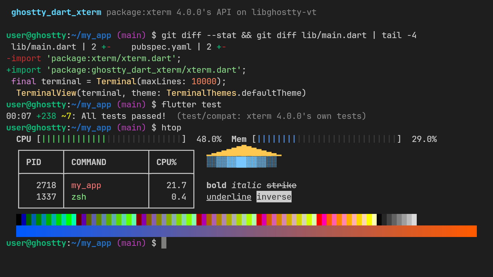

<!-- source: README.md@41ace282ee50ed8996ec51c391ad3152888764d3 -->
[English](https://github.com/AlonsoMCarlos/ghostty_dart/blob/main/packages/ghostty_dart_xterm/README.md) | **Español**

# ghostty_dart_xterm

[](https://pub.dev/packages/ghostty_dart_xterm)
[](https://pub.dev/packages/ghostty_dart_xterm/score)
[](https://github.com/AlonsoMCarlos/ghostty_dart/actions/workflows/ci.yml)
[](https://github.com/AlonsoMCarlos/ghostty_dart/blob/main/packages/ghostty_dart_xterm/LICENSE)

La API pública de [`xterm`](https://pub.dev/packages/xterm) 4.0.0
(`Terminal`, `TerminalView`, `TerminalController`, temas, manejadores de
teclado y de ratón) sobre
[`ghostty_dart_flutter`](https://pub.dev/packages/ghostty_dart_flutter)
y [`ghostty_dart`](https://pub.dev/packages/ghostty_dart), que ejecutan
[libghostty-vt](https://lib.ghostty.org/vt/) 1.x, el motor de emulación de
terminal de [Ghostty](https://ghostty.org). La mayoría de las aplicaciones
pasan de `xterm` a este paquete cambiando el *import*.

> [!NOTE]
> **No oficial.** Es un proyecto independiente, sin afiliación, respaldo
> ni patrocinio del proyecto Ghostty ni de Hack Club, ni de los autores de
> `xterm`. «Ghostty» es una marca de sus respectivos titulares y aquí solo
> se usa para describir la base de este paquete.

> [!IMPORTANT]
> **No es un reemplazo directo.** Cada miembro de xterm 4.0.0 y su
> estado (igual, distinto, previsto, no se soportará) figura en el
> [`COMPATIBILITY.md`](https://github.com/AlonsoMCarlos/ghostty_dart/blob/main/packages/ghostty_dart_xterm/COMPATIBILITY.md)
> generado, y lo que esas diferencias suponen para una aplicación está en
> la [guía de migración](https://github.com/AlonsoMCarlos/ghostty_dart/blob/main/packages/ghostty_dart_xterm/MIGRATING_FROM_XTERM.es.md).



Todavía no hay demo web en vivo: espera al *backend* web (wasm) de
`ghostty_dart`.

- **La API de xterm, comprobada por máquina.** Los mismos nombres de
  clases, miembros y parámetros que `xterm` 4.0.0. Un análisis con el
  *analyzer* compara ambas API en cada ejecución de CI; los tests de xterm
  están portados y se ejecutan contra este paquete, y sus ejemplos con
  `flutter_pty` y `dartssh2` compilan cambiando solo el *import*.
- **El motor de Ghostty.** El análisis de secuencias, la pantalla, el
  historial, el *reflow*, la codificación de teclas (incluido el protocolo
  de teclado de Kitty) y los informes de ratón vienen de libghostty-vt 1.0
  en lugar de un emulador en Dart.
- **El renderizador de `ghostty_dart_flutter`.** `TerminalView` es un
  `VtTerminalView`: solo se redibujan las filas que cambiaron, desde un
  atlas de glifos, con IME y teclados en pantalla incluidos.

## Plataformas

| Plataforma | Estado | Probado |
|---|---|---|
| Linux, macOS, Windows | ✅ | Tests en CI en las tres |
| Android, iOS | ⚠️ | Aún no probado en un dispositivo |
| Web | — | Previsto: requiere un *backend* wasm en `ghostty_dart` |

## Inicio rápido

Cambia la dependencia y el *import*:

```yaml
dependencies:
  # xterm: ^4.0.0
  ghostty_dart_xterm: ^0.1.0
```

```dart
// import 'package:xterm/xterm.dart';
import 'package:ghostty_dart_xterm/xterm.dart';

final terminal = Terminal(maxLines: 10000);
terminal.onOutput = (data) => pty.write(utf8.encode(data)); // teclas, pegados, respuestas
terminal.write('Hello, world!\r\n');

// En build():
TerminalView(terminal, autofocus: true);

// Al terminar (no existe en xterm: el terminal ocupa memoria nativa):
terminal.dispose();
```

[`example/lib/main.dart`](https://github.com/AlonsoMCarlos/ghostty_dart/blob/main/packages/ghostty_dart_xterm/example/lib/main.dart)
es el ejemplo de xterm con una shell simulada, portado: una aplicación
completa que funciona sin pty.

## Migrar desde xterm

En una aplicación típica (una shell con `flutter_pty`, una sesión de
`dartssh2`, un teclado virtual como `inputHandler` propio), cambiar el
*import* es toda la migración, más `terminal.dispose()`. Lo que puedes
notar:

- Las teclas que se escriben en `TerminalView` las codifica libghostty-vt,
  así que algunas secuencias de bytes difieren del *keytab* de xterm (por
  ejemplo, el protocolo de teclado de Kitty cuando el programa lo pide). Un
  `inputHandler` propio sigue recibiendo todas las teclas, como en xterm.
- Los informes de ratón usan la fila correcta (xterm 4.0.0 envía una fila
  de menos).
- La pantalla que no está activa (la principal mientras se ejecuta un
  programa a pantalla completa) se lee como líneas en blanco.
- `maxLines` es aproximado: el historial se descarta en páginas enteras,
  así que se conserva algo más.
- Un `TerminalView` por `Terminal`, y todavía sin web.

La [guía de migración](https://github.com/AlonsoMCarlos/ghostty_dart/blob/main/packages/ghostty_dart_xterm/MIGRATING_FROM_XTERM.es.md)
explica cada diferencia con código.

## Benchmarks

Este paquete todavía no se ha medido por sí solo. Lo que tiene debajo sí,
frente a `xterm` 4.0.0 con los mismos flujos de bytes:

- **Análisis de secuencias:** `ghostty_dart` consumió la salida de un pty
  entre 3,3 y 7,6 veces más rápido que el más rápido de `xterm` 4.0.0 y
  `xterm2_core`
  ([benchmark del *parser*](https://github.com/AlonsoMCarlos/ghostty_dart/blob/main/benchmarks/README.md#results)).
  `Terminal.write` pasa por el mismo *parser*, más una notificación a los
  oyentes por bloque.
- **Fotogramas:** la vista de `ghostty_dart_flutter`, que `TerminalView`
  envuelve, gastó unas 23 veces menos tiempo de UI por fotograma que la de
  `xterm` 4.0.0 cuando cambian unas pocas filas, y 3,5 veces menos con una
  pantalla completa de texto nuevo
  ([benchmark de fotogramas](https://github.com/AlonsoMCarlos/ghostty_dart/blob/main/benchmarks/README.md#frame-time-benchmark-widgets)).
  El trabajo propio del adaptador en cada fotograma (sus *hooks* de
  teclado, texto y ratón) no se mide ahí.
- **Más lento:** leer `terminal.buffer.lines` construye cada línea desde
  el motor la primera vez que se accede a ella (unos 50 µs por línea de 80
  columnas en una compilación de depuración), mientras que xterm guarda las
  líneas en Dart. Sirve para copiar una selección o para una búsqueda;
  evita recorrer todo el historial en cada fotograma.

## Comparación

Datos a 12-11-2026. `xterm` es hoy la opción madura y más usada, y este
paquete existe para conservar su API.

| | `ghostty_dart_xterm` 0.1.0 | [`xterm`](https://pub.dev/packages/xterm) 4.0.0 |
|---|---|---|
| Motor | libghostty-vt 1.0.0, FFI | Dart puro |
| Web | No (previsto) | Sí |
| API | La de xterm 4.0.0, con las diferencias de `COMPATIBILITY.md` | Es la API |
| *Parser* de secuencias en Dart (`EscapeParser`, `EscapeHandler`) | No: el análisis es nativo | Sí |
| ZModem (`zmodem.dart`) | Todavía no | Sí |
| Depurador (`utils.dart`) | No | Sí |

Si hoy necesitas la web, ZModem o el *parser* en Dart de xterm, usa
`xterm`.

## Cadena de suministro

- **Dependencias además de Flutter:** `ghostty_dart_flutter` y
  `ghostty_dart`, del mismo repositorio. El *build hook* de `ghostty_dart`
  descarga una libghostty-vt precompilada para tu plataforma, la comprueba
  con un sha256 fijado en su código fuente, hace fallar la compilación si
  no coincide y nunca ejecuta código descargado. Los binarios se compilan
  en la CI de este repositorio a partir del código fuente firmado de
  upstream, con atestaciones de procedencia.
- **Sin código propio en tiempo de compilación.** Ni *build hook* ni
  código nativo. Algunas partes están portadas de `xterm` 4.0.0 (MIT), y
  cada archivo lo indica.
- El repositorio versiona sus *lockfiles*, fija sus GitHub Actions por
  *commit* y no adopta ninguna versión de una dependencia con menos de 3
  días. Los detalles están en la
  [política de seguridad](https://github.com/AlonsoMCarlos/ghostty_dart/blob/main/SECURITY.es.md).

## Documentación

- [Guía de migración](https://github.com/AlonsoMCarlos/ghostty_dart/blob/main/packages/ghostty_dart_xterm/MIGRATING_FROM_XTERM.es.md)
  y [`COMPATIBILITY.md`](https://github.com/AlonsoMCarlos/ghostty_dart/blob/main/packages/ghostty_dart_xterm/COMPATIBILITY.md)
  (en inglés)
- [`ghostty_dart_flutter`](https://github.com/AlonsoMCarlos/ghostty_dart/blob/main/packages/ghostty_dart_flutter/README.es.md),
  el *widget* que hay debajo
- [Decisión de diseño (ADR 0013, en inglés)](https://github.com/AlonsoMCarlos/ghostty_dart/blob/main/docs/internal/adr/0013-xterm-adapter-design.md)
- [Registro de cambios](https://github.com/AlonsoMCarlos/ghostty_dart/blob/main/packages/ghostty_dart_xterm/CHANGELOG.md)
  (en inglés)
- [Cómo contribuir](https://github.com/AlonsoMCarlos/ghostty_dart/blob/main/CONTRIBUTING.es.md)
  e [*issues*](https://github.com/AlonsoMCarlos/ghostty_dart/issues)

## Licencia

MIT (consulta
[LICENSE](https://github.com/AlonsoMCarlos/ghostty_dart/blob/main/packages/ghostty_dart_xterm/LICENSE)).
Algunas partes están portadas de `xterm` 4.0.0, también MIT; consulta
[`LICENSE.xterm`](https://github.com/AlonsoMCarlos/ghostty_dart/blob/main/packages/ghostty_dart_xterm/LICENSE.xterm).
libghostty-vt también tiene licencia MIT (Copyright (c) 2024 Mitchell
Hashimoto, Ghostty contributors); las aplicaciones que la distribuyen deben
incluir su aviso.
